# Quantum Key Distribution (QKD) Simulator
This projects provides code able to simulate QKD under different type of noisy environment using Qiskit, Numpy and Panda.

## How to install

## Project structure

## Documentation

### Class Diagram
Here is the full class diagram of the code base : 

```mermaid

classDiagram

    namespace distribution{
        namespace core{
            class System{
                +DensityMatrix state
                +List~String~ labels
                +add_qubits(List~String~ labels) None
                +evolve(Kraus channel, List~String~ quargs) None
            }
        }

        namespace interfaces{

            class DistributionProtocol{
                <<abstract>>
                +get_name()* String
                +get_all_param_name_and_values()* List~[String,Any]~
                +compute_raw_keys(List~String~ measurements, List~String~ labels)* [String, String]
                +apply_protocol_segment(int segment_number, System current_system)* [System, List~String~]
                +get_num_segments()* int
                +is_done(List~String~ measurements, List~String~ labels)* bool
            }

            class Environment{
                <<abstract>>
                +get_name()* String
                +get_all_param_and_values()* List~[String, Any]~
                +compute_eve_bits_from_measurements(List~String~ measurements, List~String~ labels)* String
                +apply_environment_after_segment(System system, int segment, List~String~ transmitted_qubits)* System
            }
        }
    }

    namespace reconciliation{
        namespace interfaces{
            class ReconciliationProtocol{
                <<abstract>>
                +get_name()* String
                +get_all_param_name_and_values()* List~[String, Any]~
                +reconciliate_keys(String alice_raw_key, String bob_raw_key)* [String,String]
            }
        }
    }

    namespace amplification{
        namespace interfaces{
            class AmplificationProtocol{
                <<abstract>>
                +get_name()* String
                +get_all_param_name_and_values()* List~[String, Any]~
                +amplify_keys(String alice_raw_key, String bob_raw_key)* [String,String]
            }
        }
    }


     namespace data_management{
        namespace models{
            class DataBase{
                + DataFrame run
                + DataFrame distribution_protocol
                + DataFrame distribution_parameters
                + DataFrame environment 
                + DataFrame environment_parameters
                + DataFrame run_labels
                + DataFrame raw_measurements
                + DataFrame reconciliation 
                + DataFrame reconciliation_protocol 
                + DataFrame reconciliation_parameters
                + DataFrame amplification
                + DataFrame amplification_protocol
                + DataFrame amplification_parameters
                + load_run(String protocol_name, String environment_name) int
                + load_distribution_protocols(List&ltCallable&ltDictionary&ltString,Any&gt,DistributionProtocol&gt&gt distribution_protocols) None
                + load_distribution_parameters(int run_id, List~[String, Any]~ params) None
                + load_environments(List&ltCallable&ltDictionary&ltString,Any&gt,Environment&gt&gt environments) None
                + load_environments_parameters(int run_id, List~[String, Any]~ params) None
                + load_run_labels(int run_id, List~String~ String) None
                + load_raw_measurements(int run_id, List~String~ measurements) None
                + load_reconciliation_protocols(List&ltCallable&ltDictionary&ltString,Any&gt,ReconciliationProtocol&gt&gt reconciliation_protocols) None
                + load reconciliation(String protocol_name, int run_id, String alice_key, String bob_key) int
                + load reconciliation_parameters(int reconciliation_id, List~[String, Any] params) None
                + load_amplification_protocols(List&ltCallable&ltDictionary&ltString,Any&gt,AmplificationProtocol&gt&gt amplification_protocols) None
                + load_amplification(String protocol_name, int reconciliation_id, String alice_key, String bob_key) int
                + load_amplification_parameters(int amplification_id, List~[String ,Any] params) None
            }
        }

        namespace schema{
            class DistributionProtocolColumns{
                <<enumeration>>
                +NAME$
                +CONSTRUCTOR$
            }

            class RunColumns{
                <<enumeration>>
                +ID$
                +PROTOCOL_NAME$
                +ENVIRONMENT_NAME$
            }

            class DistributionParametersColumns{
                <<enumeration>>
                +RUN_ID$
                +NAME$
                +VALUE$
            }

            class EnvironmentColumns{
                <<enumeration>>
                +NAME$
                +CONSTRUCTOR$
            }

            class EnvironmentParametersColumns{
                <<enumeration>>
                +RUN_ID$
                +NAME$
                +VALUE$
            }

            class RunLabelsColumns{
                <<enumeration>>
                +RUN_ID$
                +QUBIT_NUM$
                +QUBIT_LABEL$
            }

            class RawMeasurementColumns{
                <<enumeration>>
                +RUN_ID$
                +ITERATION$
                +MEASUREMENT
            }

            class ReconciliationProtocolColumns{
                <<enumeration>>
                +NAME$
                +CONSTRUCTOR$
            }

            class ReconciliationColumns{
                <<enumeration>>
                +ID$
                +PROTOCOL_NAME$
                +RUN_ID$
                +ALICE_KEY$
                +BOB_KEY$
            }

            class ReconciliationParametersColumns{
                <<enumeration>>
                +RECONCILIATION_ID$
                +NAME$
                +VALUE$
            }

            class AmplificationProtocolColumns{
                <<enumeration>>
                +NAME$
                +CONSTRUCTOR$
            }

            class AmplificationColumns{
                <<enumeration>>
                +ID$
                +PROTOCOL_NAME$
                +RECONCILIATION_ID$
                +ALICE_KEY$
                +BOB_KEY$
            }

            class AmplificationParametersColumns{
                <<enumeration>>
                +AMPLIFICATION_ID$
                +NAME$
                +VALUE$
            }

            class DataBaseFileNames{
                <<enumeration>>
                +RUN$
                +DISTRIBUTION_PARAMETERS$
                +ENVIRONMENT_PARAMETERS$
                +RUN_LABELS$
                +RAW_MEASUREMENTS$
                +RECONCILIATION$
                +RECONCILIATION_PARAMETERS$
                +AMPLIFICATION$
                +AMPLIFICATION_PARAMETERS$
            }
        }

        namespace utils{
            class utils{
            + save_db_in_folder(DataBase db, Path folder_path)$ None
            + load_db_from_folder(Path folder_path)$ DataBase
            }
        }
    }


```


### Entity Relationship Diagram (ERD)
Here is the entity relationship diagram of the different DataFrames of the `DataBase` class: 

```mermaid
---
    config : 
        layout : elk
---
erDiagram

    run }o -- || distribution_protocol : "uses"
    run }o -- || environment : "uses"
    run || -- o{ distribution_parameters : "may have"
    run || -- o{ environment_parameters : "may have"
    run || -- |{ raw_measurements : "produces"
    run || -- |{ run_labels : "uses"
    reconciliation }o -- || run : "reconciles keys of"
    reconciliation }o -- || reconciliation_protocol : "uses"
    reconciliation || -- o{ reconciliation_parameters : "may have"
    amplification }o -- || reconciliation : "amplifies keys' secrecy of"
    amplification }o -- || amplification_protocol : "uses"
    amplification || -- o{ amplification_parameters : "may have"

    distribution_protocol{
        String name PK
        Callable~Dictionary~String-Any~-DistributionProtocol~ constructor
    }

    run{
        int id PK
        String protocol_name FK
        String environment_name
    }

    distribution_parameters{
        int run_id PK,FK
        String name Pk
        Any value
    }

    environment{
        String name PK
        Callable~Dictionary~String-Any~-Environment~ constructor
    }


    environment_parameters{
        int run_id PK,FK
        String name PK
        Any value
    }

    run_labels{
        int run_id PK,FK
        int qubit_num PK
        String qubit_label
    }

    raw_measurements{
        int run_id PK,FK
        int iteration PK
        String measurement
    }

    reconciliation{
        int id PK
        String protocol_name FK
        int run_id FK
        String? Alice_key
        String? Bob_key
    }

    reconciliation_protocol{
        String name PK
        Callable~Dictionary~String-Any~-ReconciliationProtocol~ constructor
    }

    reconciliation_parameters{
        int reconciliation_id PK,FK
        String name PK
        Any value
    }

    amplification{
        int id PK
        String protocol_name FK
        int reconciliation_id FK
        String? alice_key
        String? bob_key
    }

    amplification_protocol{
        String name PK
        Callable~Dictionary~String-Any~-AmplificationProtocol~ constructor
    }

    amplification_parameters{
        int amplification_id PK,FK
        String name PK
        Any value
    }
```

### How to use ?

#### How to add new QKD protocols

#### How to add new environments

#### How to run a simulation

#### How to add new information reconciliations protocols

#### How to add new privacy amplification protocols 